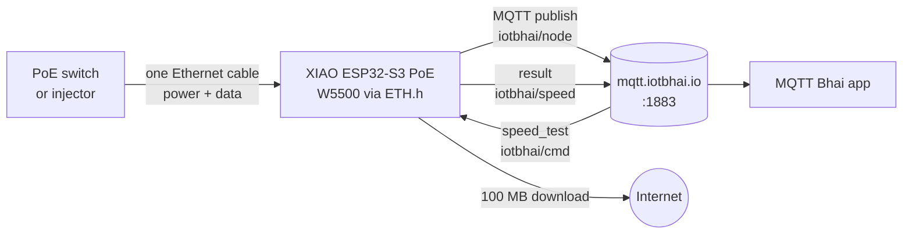

<div align="center">

# ESP32 Ethernet Speed Test over MQTT

### PoE + W5500 on the Seeed Studio XIAO ESP32-S3

*One cable for power and data. Send one MQTT command, get your real network speed back.*


**[Watch the video](#video)** · **[Quick start](#quick-start)** · **[MQTT topics](#mqtt-topics)** · **[Part 2: WiFi failover](#whats-next-part-2)**

</div>

---

## What this project does

A XIAO ESP32-S3 PoE board that works entirely over a **wired Ethernet cable**:

1. Gets power **and** network from one PoE cable (no USB adapter, no WiFi password).
2. Gets an IP over DHCP and **proves real internet access** (DNS lookup plus an HTTP `200 OK`).
3. Connects to an MQTT broker and **publishes live sensor data** every 2 seconds.
4. Runs a **100 MB speed test on demand**: publish `speed_test` and the board replies with the measured speed.

This is **Part 1** of a two-part series by **IoT Bhai**, in collaboration with **Seeed Studio**.

## Video

> **Watch:** `[add YouTube link]`
>
> **Part 2, "I Killed the WiFi and My Sensor Didn't Care":** `[add YouTube link]`

## Hardware

| Part | Details |
|---|---|
| **Board** | Seeed Studio **XIAO ESP32-S3 PoE** (XIAO ESP32-S3 Plus + W5500 + PoE) |
| Ethernet | WIZnet **W5500** over SPI, driven by the built-in `ETH.h` |
| PoE | IEEE 802.3af, MQ7813T120 (power and data over one cable) |
| WiFi | 2.4 GHz, rod antenna 2.81 dBi (not used in Part 1) |
| Network | A PoE switch or injector, plus a Cat5e/Cat6 cable |

**Get the hardware from Seeed Studio:**

- [XIAO W5500 Ethernet Adapter](https://www.seeedstudio.com/XIAO-W5500-Ethernet-Adapter-p-6472.html?sensecap_affiliate=itSHeV7&referring_service=link)

> This is an affiliate link. It costs you nothing extra and supports the IoT Bhai channel.

## Pinout

The W5500 is already wired to the XIAO pins below on the board. You don't need to wire anything for Ethernet.

| Signal | XIAO pin | Purpose |
|---|---|---|
| W5500 CS | `D1` | Chip select |
| SPI SCK | `D8` | Clock |
| SPI MISO | `D9` | Data in |
| SPI MOSI | `D10` | Data out |
| IRQ / RST | `-1` | Not used |

**Still free for your own parts:** `A0/D0` (analog sensor) and `D4/D5` (I²C OLED, SDA and SCL).

## How it works



`ETH.h` registers the W5500 into the same lwIP network stack that WiFi uses, so ordinary `NetworkClient` and `PubSubClient` code works over Ethernet with no special library.

## Quick start

### 1. Arduino IDE setup

| Setting | Value |
|---|---|
| Board | **XIAO_ESP32S3** (this defines the `D0` to `D10` pin macros) |
| Core | **arduino-esp32 3.1.0 or newer** (W5500 over SPI needs core 3.x) |
| Library | **PubSubClient** (install from the Library Manager) |
| Ethernet | Built-in `ETH.h`. Do **not** install the Arduino `Ethernet` library. |

### 2. Flash

1. Open [`esp32_s3_poe_ethernet_mqtt/esp32_s3_poe_ethernet_mqtt.ino`](esp32_s3_poe_ethernet_mqtt/esp32_s3_poe_ethernet_mqtt.ino).
2. Check the MQTT settings at the top of the sketch (broker, credentials if your broker needs them).
3. Select the board and port, then upload.

### 3. Run

1. Plug the Ethernet cable into a PoE switch or injector. The board powers up.
2. Open the Serial Monitor at **115200 baud**.
3. Subscribe to `iotbhai/node` in the **MQTT Bhai** app (or any MQTT client).

Expected Serial output:

```text
=== IoT Bhai - Part 1: Ethernet -> MQTT ===
[eth] cable connected, link up
MAC     : AA:BB:CC:DD:EE:FF
IP      : 192.168.1.xx
Gateway : 192.168.1.1
[net] DNS lookup example.com ... 93.x.x.x
[net] HTTP GET example.com ... HTTP/1.1 200 OK
[net] internet OK
[mqtt] connect mqtt.iotbhai.io:1883 : OK
[mqtt] {"link":"ETH","sensor":8.0,"count":1,"wifi":0,"eth":1}
```

## MQTT topics

| Topic | Direction | Payload |
|---|---|---|
| `iotbhai/node` | board to broker | Sensor data JSON every 2 s |
| `iotbhai/cmd` | broker to board | `speed_test` |
| `iotbhai/speed` | board to broker | Speed test status and result JSON |

**Sensor payload**

```json
{"link":"ETH","sensor":42.0,"count":123,"wifi":0,"eth":1}
```

| Field | Meaning |
|---|---|
| `link` | Active interface |
| `sensor` | Sensor reading (a placeholder that counts seconds until you wire a real sensor) |
| `count` | Number of messages published |
| `wifi`, `eth` | Per-interface up flags |

## Speed test

Publish the text `speed_test` to `iotbhai/cmd`. The board downloads a 100 MB file over Ethernet, discards the data, and replies on `iotbhai/speed`.

```json
{"status":"running","link":"ETH"}
{"status":"done","link":"ETH","mbps":87.40,"mb_per_s":10.93,"bytes":104857600,"ms":9598}
```

- The test uses **plain HTTP** on purpose, so it measures the link rather than TLS overhead.
- It stops after 100 MB or 3 minutes, whichever comes first, and reports what it got.
- Regular sensor publishes pause during the test and resume afterwards.
- The W5500 runs over SPI, so expect results well under the full 100 Mbps line rate.
- The default test file is `speedtest.tele2.net/100MB.zip`. Change `SPEED_HOST` and `SPEED_PATH` in the sketch to use another plain-HTTP file of about 100 MB.

> **Security note:** anyone who can publish to `iotbhai/cmd` on your broker can trigger the test. On a shared public broker, use your own topic prefix or broker credentials.

## Troubleshooting

| Problem | Fix |
|---|---|
| `D1`, `D8` and similar are "not declared" | You selected the wrong board. Choose **XIAO_ESP32S3**, not "ESP32S3 Dev Module". |
| `ETH.begin` does not compile | Your core is too old. Update arduino-esp32 to **3.1.0 or newer**. |
| Stuck on "waiting for Ethernet" | Check the cable and switch, and that the PoE source supports 802.3af. |
| IP works but "no internet yet" | The router has no internet, or DNS is blocked. Test with another device. |
| MQTT `connect ... fail` | Check the broker address and port, and your network firewall. |
| Speed test returns an error | The test file host may be down. Change `SPEED_HOST` and `SPEED_PATH`. |

## Project layout

```text
.
├── README.md
├── LICENSE
└── esp32_s3_poe_ethernet_mqtt/
    └── esp32_s3_poe_ethernet_mqtt.ino    # Part 1 firmware
```

## What's next: Part 2

Part 1 gets the node online over Ethernet. In **Part 2** the node runs on WiFi, and when I kill the WiFi it **fails over to Ethernet automatically** while the MQTT publish counter keeps climbing.

## About

Made by **IoT Bhai** in collaboration with **Seeed Studio**.

`esp32 ethernet` · `w5500` · `power over ethernet` · `PoE` · `MQTT` · `XIAO ESP32-S3`

## License

Released under the [MIT License](LICENSE).
